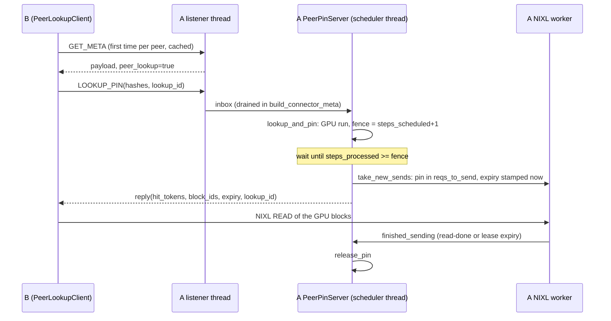
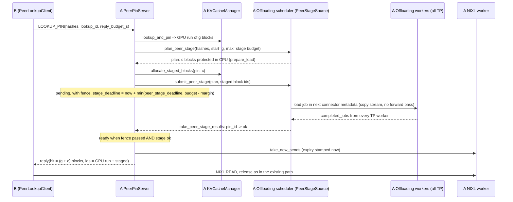

# Peer pin: staging A's CPU blocks, and the fallback

Status: draft r2, 2026-11-27 (review folded in: no copies of GPU-resident blocks, job shape set by measurement, staged blocks stay unhashed, trim reason is a choice). Builds on vllm-project/vllm#68430 at b0213e8fb3.

The proposal is in the [RFC 65967 comment](https://github.com/vllm-project/vllm/issues/65967#issuecomment-6982172673). When a lookup hits blocks that sit only in A's CPU offload cache, A copies them into fresh GPU blocks before it replies, so B can read them over NIXL as usual.

[Rishabh's reply](https://github.com/vllm-project/vllm/issues/65967#issuecomment-7155741449) confirms two things already hold:
- the lease starts when the reply ships, so the wait costs B nothing;
- B already handles a partial hit.

What's missing is the fallback. Today a slow pin is dropped whole with `pin_refused`. When staging misses its deadline, A must instead cut the pin back to the GPU run and still reply. This doc designs that, plus the staging path it falls back from.

**Out of scope:** B reading A's CPU memory directly, disk tiers, hybrid or multi-group layouts, and DCP/PCP (already refused).

## 1. Integration points

| # | Where | Change |
|---|---|---|
| I1 | `nixl/metadata.py` `LookupPinRequest`, `PeerMissReason` | New optional `reply_budget_s: float \| None = None`: how long B will wait for the reply. Older engines ignore it, like `lookup_id`. Its presence also tells A the consumer decodes the new miss value `stage_timeout` (section 3). |
| I2 | `nixl/pull_scheduler.py` (consumer) | Sets `reply_budget_s` from the client's lookup timeout. Nothing else changes on B. |
| I3 | `v1/core/kv_cache_manager.py` `PrefixPin` | The pin's reply ids become a per-position list that need not be contiguous. After the GPU run, a position is either a GPU-cached block pinned in place (`pin_cached_at(pin, positions)` touches it by hash) or a staged block. `staged: list[KVCacheBlock]` are fresh, unhashed blocks from `allocate_staged_blocks(pin, n, min_free_blocks)`. `detach_staged(pin) -> DetachedBlocks(staged, in_place)` removes the first staged block and every position after it, without freeing; the two lists are freed at different times (staged only after the copy reports), through `free_detached`. `pin_cached_at` takes only the pin's next consecutive positions. `release_pin` frees both kinds. `num_pinned_blocks` counts both. |
| I4 | new `kv_connector/v1/peer_stage.py` | `PeerStageSource` protocol (below). It is the only interface between the NIXL and offloading connectors. |
| I5 | `offloading/scheduler.py` `OffloadingConnectorScheduler` | Implements `PeerStageSource`. A peer-stage job is a load job with no request. It gets a synthetic `ReqContext(req_id=pin_id, load_tier_filter=<CPU tier only>)`, its destination blocks go into `_current_batch_allocated_block_ids` so pending stores of reused blocks are flushed first, and `_update_connector_output` gets a branch that calls `complete_load` without a `req_status`. |
| I6 | `offloading/worker.py` | Peer-stage loads are async loads tracked under a sentinel req id. They are never added to `finished_recving`, because the scheduler has no request with that id, and a failure is reported in `failed_jobs` without raising. |
| I7 | `multi_connector.py` | After building its children, hands the first child that provides a `PeerStageSource` to every child that accepts one (`set_peer_stage_source`). Without a MultiConnector, or without an offloading child, nothing is wired and staging is off. |
| I8 | `nixl/base_scheduler.py` | New knobs `peer_stage` (off by default), `peer_stage_max_fraction` (10%) and `peer_stage_deadline` (1.5 s). Passes the source and knobs to `PeerPinServer` in `bind_kv_cache_manager`. Feeds `take_peer_stage_results()` to the server every step. |
| I9 | `nixl/peer_pins.py` `PeerPinServer` | Staging state on `_PendingPin`. A reply is ready only when the fence has passed and the stage is done. Adds the deadline and trim logic (section 3), a `_draining` set for in-flight blocks that were trimmed off, and counts staging and draining in `has_pending_work`. |
| I10 | `PeerLookupInfo` (discovery), Python and the Rust mirror (`rust/src/engine-core-client/src/protocol/handshake.rs`, `python_compat.py`, route tests) | `cpu_stage: bool`, true only when I7 wired a source and `peer_stage` is on; `#[serde(default)]` on the Rust side. The router credits HostPinned blocks only on peers that set it. |

### `PeerStageSource`

```python
class PeerStageSource(Protocol):
    def plan_peer_stage(
        self, stage_id: str, block_hashes: Sequence[BlockHash], start_block: int,
        max_blocks: int,
    ) -> StagePlan | None:
        """Walk block_hashes[start_block:] in the CPU tier and protect the hits.

        Holds the manager lock from lookup through prepare_load, so no
        eviction can slip in between. The walk stops at the first chunk that
        misses, or at an async lookup (RETRY / HIT_PENDING). Returns None on
        no hit. The plan holds num_blocks plus the keys it protected.
        """

    def submit_peer_stage(self, plan: StagePlan, dst_block_ids: list[int]) -> None:
        """Queue the H2D load; it goes out in the next build_connector_meta."""

    def abandon_peer_stage(self, plan: StagePlan) -> None:
        """Planned but never submitted (allocation failed): unprotect the keys."""

    def take_peer_stage_results(self) -> dict[str, bool]:
        """stage_id -> success, once every TP worker has reported the job."""
```

Notes behind these signatures:
- **Chunks:** offload keys are per chunk (`hashes_per_chunk` blocks, keyed by the chunk's last block hash). The GPU run may end mid-chunk; the plan then starts at that chunk and skips its leading blocks through `GPULoadStoreSpec.block_indices`, as `update_state_after_alloc` already does.
- **Lock:** `serve` runs inside NIXL's `build_connector_meta`. If the offloading step region is open, the plan joins it; otherwise it takes a short `_manager_locked()` region. It never opens a step region that would outlive the step.
- **Mixed runs (GPU, CPU, GPU): never copy a block A already holds on GPU.** Free blocks are what the floor protects, so the walk spends them only on positions with no GPU copy. Per chunk after the GPU run:
  - a chunk whose needed blocks are all GPU-cached loads nothing; its blocks are pinned in place;
  - GPU-cached blocks at the start of a chunk are pinned in place and skipped with `block_indices`, as `update_state_after_alloc` does;
  - from the first block with no GPU copy to the end of the chunk, every block is staged. A GPU-cached block in that range is a real hole: the load spec cannot skip it, so it is copied. This is the only duplicate copy.
- The walk stops at the first position that is in neither tier.

### Hard constraints

These are load-bearing and get their own asserts and tests:
- **Never a sync load.** The peer-stage job goes through the async load path. The sync path blocks the step and raises on failure (`offloading/worker.py`, "sync load job failed").
- **The sentinel never reaches a request loop.** The sentinel id is filtered out of `finished_recving`, `invalid_block_ids` and any per-request scheduler loop before the scheduler sees it, the same way pin ids are filtered today.
- **Destination blocks are not zeroed under the copy.** Staged blocks are allocated inside `build_connector_meta`. They must not be queued for zeroing after the load is queued (`take_new_block_ids`), and the load stream already waits on the compute stream, so zeroing queued earlier finishes first.

### Job shape: measure first

The copy stream runs transfers in order: each transfer's stream waits on the previous transfer's end event (`cpu/gpu_worker.py`). So if A issues one job per chunk, the chunks that finished always form a prefix, with no extra stream.

Which shape v1 uses is decided by a measurement, before the interface is fixed:
- **M0 (Modal, A100-80GB, Qwen3-8B, OffloadingConnector):** time from load submit to the last TP worker's report, for tails from 1% to 10% of the GPU pool. Run it on an idle engine and under concurrent store traffic, because a store queued ahead delays the load.
- **If p99 for a 10% tail is under 0.5 s under load** (half the 1 s deadline): one job per pin. A deadline miss is then rare, and all-or-nothing costs little.
- **Otherwise: one job per chunk.** On a deadline, A keeps the finished chunk prefix and trims the rest.

#### M0 result (2026-11-27, run `offload_load_latency-20261127-151528`)

A100-80GB, Qwen3-8B, stock `main` 9df94b9977. Times are submit to scheduler report, in ms. "Loaded" means about 14 running and about 9.8k prompt tok/s.

| tail | idle p50 / p99 | loaded p50 / p99 | copy only |
|---|---|---|---|
| 4k (0.6 GB, 1% pool) | 29 / 30 | 730 / 931 | 24 |
| 8k (1.2 GB) | 54 / 55 | 949 / 954 | 49 |
| 16k (2.4 GB) | 106 / 107 | 993 / 1005 | 97 |
| 32k (4.8 GB, 8% pool) | 203 / 206 | 1092 / 1101 | 194 |
| 3 × 32k at once, loaded | | 1300 / 1459 | 194 each |

- The copy runs at about 24 GB/s and is at most 0.2 s.
- Under load, the latency is about two engine steps. The load waits for the forward pass in flight, and then the report trails by one step (worker-seen median 0.39 s, report median 0.71 s).
- Where a staged load waits on a busy A (one step is about 0.35 s):
  1. Step N: the scheduler plans the copy into step N's metadata. No wait.
  2. The copy stream waits for the forward pass already running (`wait_stream` on the compute stream). Up to one step.
  3. The copy itself takes 24 ms for 4k tokens and 0.2 s for 32k.
  4. The worker polls finished transfers once per step (`get_finished`), and sees the job about 0.39 s after submit.
  5. The result travels back with that step's output. Under async scheduling the scheduler reads it one step later, 0.33 s more.
  6. The reply ships in the next `take_new_sends`, unless the fence is still holding it. That step is inferred from the code; M0 covers steps 1 to 5.
- The 0.5 s rule says per chunk. Its premise was that the copy dominates, and that is false. Per-chunk jobs would all report in the same step, so they keep nothing that one job would not. **Decision: one job per pin.**
- A 1 s deadline misses on a loaded A at every size. The deadline therefore follows B's budget (`reply_budget_s` minus the margin), and `peer_stage_deadline` defaults to 1.5 s, which covers the concurrent p99.
- On a busy A, staging a small tail loses to recomputing it on an idle B. A 4k tail takes 0.73 s to stage against 0.31 s to recompute, and an 8k tail 0.95 s against 0.69 s. The break-even is near 10k to 12k tokens here. Staging needs a skip rule (open question 3).

The two shapes change only `take_peer_stage_results`:
- one job: `dict[str, bool]` (stage id to success);
- per chunk: `dict[str, StageProgress(done_blocks, failed)]`, where `done_blocks` is the finished prefix.

### As built (slice 2)

The implementation differs from the sketch above in these ways, all accepted in review:
- **Signature:** `plan_peer_stage(stage_id, block_hashes, start_block, gpu_cached: Sequence[bool], max_staged_blocks) -> StagePlan | None`. The server works out the GPU side and passes `gpu_cached` per position; the source does only the CPU walk and chunk keys. `StagePlan` carries `stage: list[bool]` (copy or pin in place), `staged_bytes` and its stop reason. `can_stage` is False when the layout can never stage, and gates `cpu_stage`.
- **One contiguous run:** a load job covers one unbroken run of blocks. A walks the first CPU run after the GPU run. Leading GPU blocks of its first chunk are skipped with `block_indices`, and GPU blocks inside later chunks of the run are copied. An all-GPU chunk ends the run, and trailing GPU blocks are pinned in place. A second CPU run, as in (CPU, GPU, CPU), is not staged.
- **MultiConnector** delegates `get_peer_lookup_info`; before this change, discovery under NIXL + Offloading returned nothing. List NIXL before Offloading: the reverse order still works, but the copy goes out one step later.
- **Reset:** a queued copy fails at once. An in-flight copy reports failure only after every worker has reported, and its synthetic request is finished.
- **Nothing kept** after a trim: A replies with a miss at once, without waiting for the fence.
- **Skip rule (closes open question 3):** A-side estimate `2 × step EMA + staged bytes / 20 GB/s` per worker. The EMA uses only gaps of 2 s or less, so an idle A estimates copy time alone. A skips when the estimate exceeds the deadline, or the recompute time at `peer_stage_recompute_tokens_per_s` (default 10,000; 0 turns that half off). Trim reason `skipped`.
- **Deadline granularity:** the request's receipt time at the listener is its start, and A trims when `now + step EMA >= deadline`, so a trimmed reply still lands inside B's budget.

## 2. Request flow

### Existing path (GPU only)



### New path (GPU run + CPU part)



Each step:
1. `serve` checks identity and budget as today, then pins the GPU run with `lookup_and_pin`.
2. If staging is on and the GPU run stopped short (miss is `NOT_CACHED` or `EVICTED`), the stage budget is the smallest of three things: the pin budget left, the stage cap (`peer_stage_max_fraction` of the pool minus blocks already staged), and the hashes remaining. `plan_peer_stage` walks the CPU tier from block `g`.
3. If the plan returns `c > 0` blocks, the server allocates `c` blocks with the same free-block floor. If allocation fails, it calls `abandon_peer_stage` and continues GPU-only.
4. `submit_peer_stage` queues the load. The pin becomes pending with a `stage_id` (= pin id) and a stage deadline.
5. Every step, the server takes stage results. A pending pin ships when `fence <= steps_processed` and its stage succeeded. A pin with no stage ships on the fence alone, as today.
6. From shipping on, staged blocks are ordinary pinned blocks. Read-done, heartbeat, lease expiry and `release_pin` all work unchanged.

Why the step fence isn't enough for staged blocks: no forward step writes them; the copy stream does. They are safe to read only once every TP worker has reported its load done. The worker reports a job only after its copy event completes, so device memory is written before NIXL reads it.

Staged blocks stay unhashed in v1, even after the copy finishes. A's scheduler therefore can't match a block that is still being written, and the offloading store path never stores it back to CPU. Hashing them later is an additive change; it only pays off when the CPU chunk has already been evicted. Undoing it once A's own requests depend on those pages would not be.

## 3. Fallback

### Triggers and actions

| Trigger | When | A replies | Staged blocks | CPU copies |
|---|---|---|---|---|
| No `PeerStageSource`, or `peer_stage` off | serve | GPU run (today) | none | none |
| CPU walk misses, or hits a RETRY / HIT_PENDING | plan | GPU run | none | not protected |
| Stage budget is 0, or allocation fails | plan / alloc | GPU run | none | `abandon_peer_stage` unprotects |
| Stage deadline passes before the job reports | each step | **trimmed** (`stage_timeout`) | detached into `_draining`, freed when the job reports | `complete_load` when the job reports |
| Job reports failure from any worker | stage result | **trimmed** (`stage_timeout`) | freed now (job is done) | `complete_load` |
| Fence passes, stage succeeded | ship | GPU run + staged | stay in the pin | `complete_load` |
| `_max_pending_seconds` (5 s) passes | each step | whole pin refused (today's backstop) | into `_draining` if still in flight | when the job reports |

### Trim

```python
def _trim_to_gpu_run(self, pending: _PendingPin, in_flight: bool) -> None:
    detached = self._manager.detach_staged(pending.pin)  # out of pin + budget
    self._manager.free_detached(detached.in_place)     # GPU pins after the cut
    if in_flight:
        self._draining[pending.pin_id] = detached.staged  # free when the job reports
    else:
        self._manager.free_detached(detached.staged)
    pending.stage = None                               # ships on the fence alone
    pending.trimmed = True
    self.stage_stats.trimmed += 1
```

- **Reply after a trim:** every position before the first staged one (the GPU run plus any in-place pins before it), shipped once the fence passes. With per-chunk jobs, the finished chunk prefix is kept too. B handles it as a partial hit, as today.
- **Miss reason after a trim: `stage_timeout`, a deliberate choice.** `pin_refused` tells the router A is short of pin budget, and a router that backs off on it would back off for the wrong reason. A slow copy is a different signal: A had the blocks, and its copy path was slow. A sends `stage_timeout` only to a consumer that sent `reply_budget_s`, since only those decode it. An older consumer gets `pin_refused`.
- **Nothing kept** (the prefix was all on CPU, or the first CPU chunk did not finish): a plain miss with the same reason.
- **Never free during a copy.** A trimmed block sits in `_draining` until its job reports, success or failure. Only then does it go back to the pool. The CPU side is unprotected at the same moment, through `complete_load`.
- **Late success after a trim:** the result is consumed, the draining blocks are freed and nothing is sent. The reply already went out.

### Deadline

- `stage_deadline = created_at + min(peer_stage_deadline, reply_budget_s - margin)`, with a margin of 0.2 s for the fence, the reply's trip back to B and B's poll interval.
- If B sent no budget (an older consumer), A uses `peer_stage_deadline` alone (1.5 s, under B's default 2 s lookup timeout).
- If the budget is already below the margin, A skips staging and replies with the GPU run.
- The deadline is checked in `take_new_sends`, before the ship loop. A pin that is trimmed in a step can therefore still ship in that same step if its fence has passed, so a trim adds no extra step to the reply.

### Interactions

- **Lease:** unchanged. The expiry is stamped at ship time, so neither staging nor trimming spends any of B's lease.
- **B gives up first** (clock skew, or a budget that is too tight): B cancels, and the pin is released by lease expiry, as for any reply B drops today.
- **Idle engine:** `has_pending_work` also counts pins with a stage in flight and the `_draining` blocks. Otherwise an idle A would never see the worker's report, and the blocks would leak until the next request.
- **Prefix cache reset or sleep:** pinned and draining blocks hold `ref_cnt`, so the reset fails until they are released. That is the stall already documented in the design page.
- **`on_invalid_blocks`:** a staged block reported invalid is handled by a failed stage job. GPU-run blocks keep today's handling.

### Metrics on A

`PeerLookupStats` gains `staged_blocks`, `stage_seconds` (histogram), `stage_trimmed{reason=deadline|failed|alloc|budget}` and `stage_draining_blocks`. These are the numbers the RFC said would decide whether direct CPU reads are worth revisiting.

## 4. Tests

Following the PR's rule: extend an existing test wherever one covers the area, and add a new test only where nothing does.

### Unit tests (CPU)

| File | Extend or add | Cases |
|---|---|---|
| `tests/v1/core/test_prefix_pin.py` | extend | Staged blocks count toward `num_pinned_blocks`, respect the free floor, are unhashed, and are freed by `release_pin`. A later GPU hit is pinned in place with no allocation, and the reply ids are non-contiguous. `detach_staged` drops staged blocks and later positions without freeing. |
| `tests/v1/kv_connector/unit/test_nixl_peer_pins.py` | extend (fake `PeerStageSource`) | (a) GPU + CPU hit ships only when both the fence and the stage are done. (b) Deadline before the stage reports: trimmed reply with `stage_timeout` (`pin_refused` when the request had no `reply_budget_s`), staged blocks held until the result, then freed. (c) Job failure: trimmed, freed at once. (d) All-CPU prefix with deadline miss: plain miss. (e) Allocation failure calls `abandon_peer_stage`. (f) Late success after a trim sends nothing. (g) `has_pending_work` is true while draining. (h) `_max_pending_seconds` backstop with a stage still in flight frees nothing until the result. (i) `lookup_id` is echoed on the trimmed reply. |
| `tests/v1/kv_connector/unit/offloading_connector/test_scheduler.py` | extend | `plan_peer_stage`: a GPU run ending mid-chunk sets `block_indices`; the walk stops at a miss and at RETRY; `prepare_load` happens inside one lock region; `abandon_peer_stage` unprotects. The job is in the next metadata, its destination blocks trigger the store flush, and completion calls `complete_load` with no `req_status`. |
| `tests/v1/kv_connector/unit/offloading_connector/test_worker.py` | extend | A peer-stage load never reaches `finished_recving`, and a failure lands in `failed_jobs` without raising. |
| `tests/v1/kv_connector/unit/test_multi_connector.py` | extend | NIXL + Offloading wires the source; NIXL alone does not, and `cpu_stage` is false. |
| `tests/v1/kv_connector/unit/test_nixl_peer_lookup_listener.py` | extend | Wire round trip with `reply_budget_s`, and an older request without it. |
| `tests/v1/kv_connector/unit/test_nixl_peer_lookup_info.py` | extend | `cpu_stage` follows wiring and the knob. |

### End to end on Modal (modelsight scratch, like `peer_lookup_compat.yaml`)

2 × A100, Qwen3-0.6B, both engines run `MultiConnector(NIXL, Offloading)`, and A has a small GPU pool so prefixes spill to CPU:
1. **CPU-only hit:** warm a prefix on A, evict it from GPU into CPU, and look it up from B. Expect a full hit, output equal to recompute, staged blocks > 0, and no leaks after release.
2. **Mixed:** a prefix with GPU, CPU and GPU parts. Expect a full hit, staged blocks equal only to the CPU part (plus any hole inside a chunk), and the later GPU part pinned in place.
3. **Deadline trim:** set `peer_stage_deadline` to 1 ms. Expect a partial hit equal to the GPU run, output equal to recompute, `stage_trimmed{deadline}` = 1, and all blocks free once the job reports.
4. **Load failure:** use an injected failing load (a test-only env flag in the offloading worker). Expect a trim, and no leak of GPU or CPU protection.
5. **Older consumer:** a B on stock #68430 (no `reply_budget_s`). Expect staging with the default deadline.
6. **Engine goes idle mid-stage:** no further requests after the lookup. Expect the reply to still arrive and the pin to be released.

The pass criteria for each case are on the same lines as today's probe: output equal to recompute, NIXL bytes moved (or 0 on a full miss), and a successful prefix-cache reset at the end.

Benchmark plan (H6, two nodes over RDMA): [peer-pin-cpu-stage-benchmark.md](peer-pin-cpu-stage-benchmark.md).

## Open questions

1. The 0.2 s margin is a guess. Measure the fence-plus-reply distribution in run 1 and set it from p99.
2. Hashing staged blocks after the copy: deferred (section 2), revisit only with store-back numbers.
3. Skip rule for small tails on a busy A (see M0). **Decided: A-side estimate** (see "As built"). The options were:
   - **A-side estimate (recommended):** A predicts the stage time as 2 × its recent step time plus bytes divided by the copy bandwidth. It skips staging when that exceeds the tail's recompute time on B at a configured rate (`peer_stage_recompute_tokens_per_s`). No wire change.
   - **B sends its rate:** B adds its prefill rate to `LookupPinRequest`, next to `reply_budget_s`. More accurate, but one more field.
4. Follow-up, separate from this design: shorten waits 4 and 5 (poll finished transfers more often than once per step, or report a peer-stage job without waiting a step). Staging would then pay off for small tails too.
